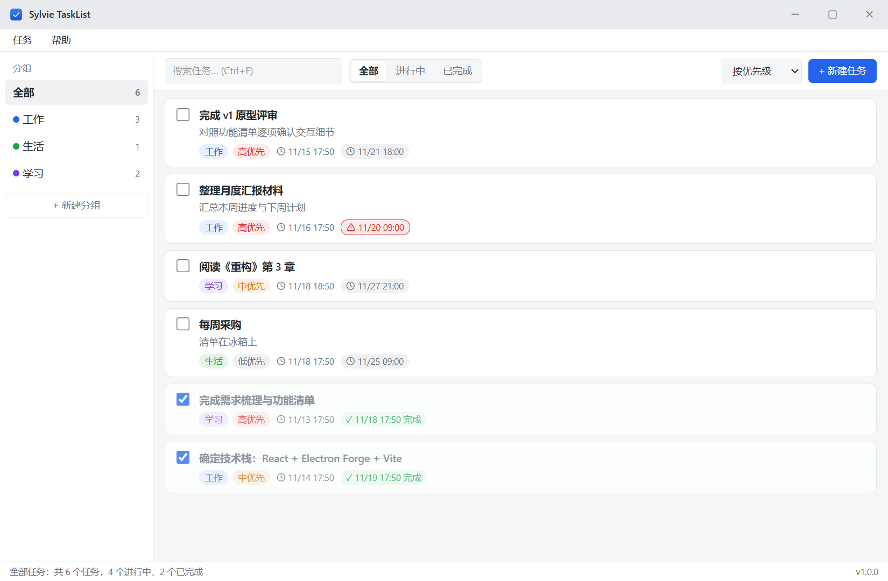
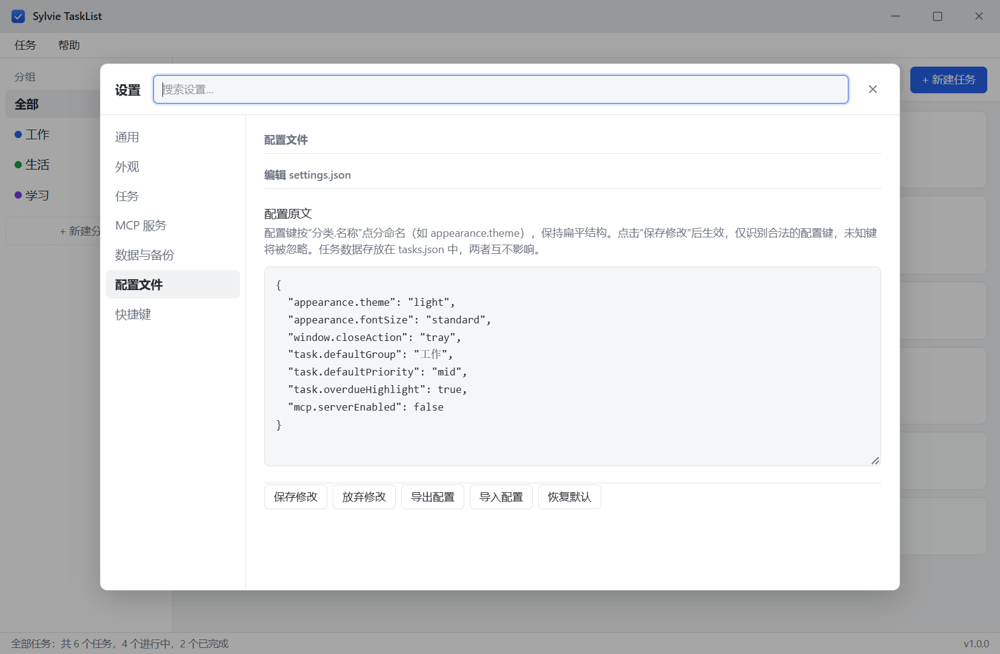
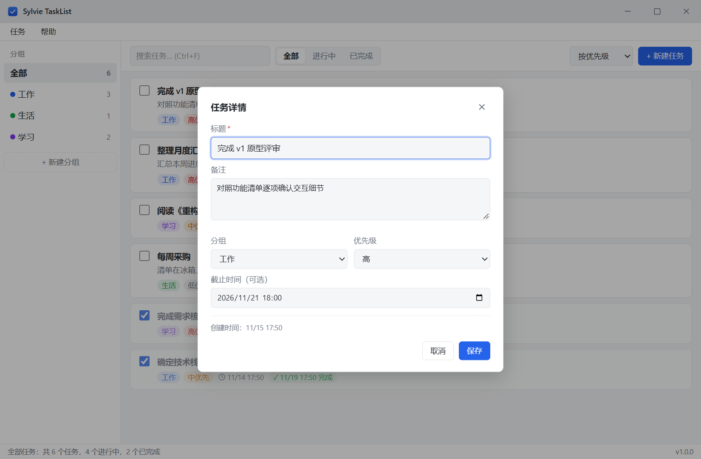
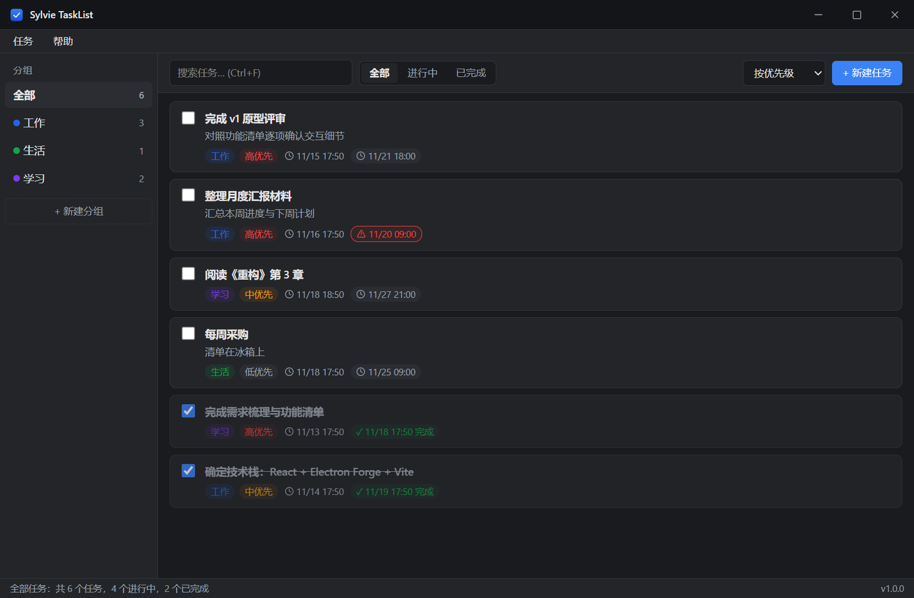

# Sylvie TaskList

> 本地任务清单桌面应用（仅 Windows）。分组、优先级、截止时间与拖拽排序，数据全部保存在本机，无网络依赖；
> 内置 MCP Server，可让 AI 助手直接读写任务。



## 功能特性

- **任务管理**：新建 / 编辑 / 删除 / 勾选完成，点击卡片直接打开详情；创建、截止、完成时间自动记录。
- **组织方式**：可设颜色的分组、高 / 中 / 低优先级、可选截止时间，逾期任务红色标记。
- **列表视图**：全部 / 进行中 / 已完成筛选，关键字搜索，自定义 / 优先级 / 截止时间 / 创建时间四种排序。
- **拖拽交互**：拖动任务自动切到「自定义排序」并持久化；拖到侧边栏直接换分组；分组本身也可拖拽排序。
- **设置中心**：VSCode 风格分类导航 + 搜索 + `settings.json` 编辑器；主题（亮 / 暗 / 跟随系统）、字号、关闭行为等。
- **数据自持**：`tasks.json` / `settings.json` 双文件，支持导入导出备份与旧格式自动迁移。
- **MCP Server**：开关即时生效，13 个工具覆盖任务与分组增删改查，状态栏显示运行指示。

## 界面预览

| 设置 · 配置文件                        | 任务详情                                      |
| -------------------------------------- | --------------------------------------------- |
|  |  |

暗色主题：



## 技术栈

- **桌面**：Electron Forge 8 + Vite 8（`plugin-vite`），Windows 打包 Squirrel.Windows / ZIP
- **界面**：React 19 + TypeScript + Tailwind CSS 4
- **状态**：zustand（`subscribeWithSelector` 订阅落盘）、perfect-debounce
- **组件**：`@sylvie/ui`（Radix Dialog / Switch、sonner、设计令牌）
- **交互**：@dnd-kit（拖拽）、motion（列表布局动画）
- **MCP**：`@sylvie/mcp`（Hono + @modelcontextprotocol/sdk，Streamable HTTP）
- **工程**：pnpm workspace + Turborepo + ESLint 9 + Prettier

## 快速开始

```bash
pnpm install

pnpm desktop:dev       # 开发模式（Vite HMR）
pnpm desktop:package   # 免安装目录 → apps/electron/dist
pnpm desktop:make      # Windows 安装包 → apps/electron/dist/make
pnpm typecheck         # 全仓库类型检查
pnpm lint              # ESLint（--max-warnings 0）
```

界面回归截图（无需 UI 自动化）：

```bash
TASKLIST_CAPTURE=shot.png pnpm desktop:dev                                  # 主界面
TASKLIST_CAPTURE=shot.png TASKLIST_CAPTURE_VIEW=settings pnpm desktop:dev   # 设置页
TASKLIST_CAPTURE=shot.png TASKLIST_CAPTURE_VIEW=task pnpm desktop:dev       # 任务详情
```

## 目录结构

```text
tasklist-monorepo/
├── apps/electron/
│   ├── forge.config.ts      # 打包与 maker（Squirrel.Windows / ZIP，输出 dist/）
│   └── src/
│       ├── main.ts          # 主进程入口：生命周期与模块装配
│       ├── main/            # context / storage / window / tray / ipc / mcp
│       ├── preload.ts       # contextBridge → window.desktop
│       └── app/             # zustand store + 业务组件（Sidebar / TaskList / SettingsPanel…）
└── packages/
    ├── core/                # 领域模型：类型 / 排序 / 迁移 / 设置 schema
    ├── ui/                  # 设计系统：Radix + sonner + 设计令牌
    ├── mcp/                 # MCP 工具 + Hono 传输（TaskListRepository 端口，不依赖 Electron）
    ├── utils/               # cn / 颜色 / 日期 / 拖拽守卫
    ├── eslint-config/       # 共享 ESLint 配置（base / react）
    └── tsconfig/            # 共享 TypeScript 配置
```

`core` 与 `ui` 以 TS 源码形式被消费（`exports` 指向 `src/index.ts`，Vite alias 直连），
省掉构建产物与 watch 流程，因此不单独发布 npm。

## 数据与配置

两份 JSON 文件，位于 `%APPDATA%/Sylvie TaskList/`：

| 文件            | 职责                                                                     |
| --------------- | ------------------------------------------------------------------------ |
| `tasks.json`    | 分组、分组颜色、任务列表                                                 |
| `settings.json` | 应用配置（点分命名空间扁键，如 `appearance.theme`、`mcp.serverEnabled`） |

<!-- prettier-ignore -->
```jsonc
{
  "id": 1,
  "createdAt": 1763612345000, // 创建时间（ms）
  "order": 1763612344999, // 自定义排序值，仅拖拽过才写入
  "done": false,
  "completedAt": null, // 取消完成时置 null
  "title": "完成 v1 原型评审",
  "group": "工作",
  "priority": "high", // high | mid | low
  "dueAt": "2026-11-21T18:00" // 空串表示未设置
}
```

容错：旧字段 `created` / `due` 自动迁移为 `createdAt` / `dueAt`（纯日期补 `T09:00`）；
未知配置键忽略、非法值回退默认；已删除分组的任务归入「未分组」。
视图状态（分组 / 筛选 / 排序 / 搜索）只存在内存中，不写盘。

## MCP Server

设置 → MCP 服务 开启后**立即生效**，状态栏右下角显示绿点。

- 端点：`POST http://127.0.0.1:37821/mcp`（Streamable HTTP），`GET /health` 探活；
  按 `mcp-session-id` 维护会话，仅监听回环地址，端口占用时自动顺延
- 工具：
  - 查询：`list_tasks`、`get_task`、`get_overview`、`list_groups`、`get_settings`
  - 任务：`create_task`、`update_task`、`set_task_done`、`delete_task`、`move_task`
  - 分组：`create_group`、`update_group`、`delete_group`
- 入参由 zod 校验；写操作统一「更新缓存 → 原子落盘 → 广播界面」

## 文档

- [功能规划](../docs/任务清单v1功能规划.md)：功能范围、交互规则与数据模型
- [交互原型](../docs/任务清单-v1原型.html)：单文件 HTML 原型
- [MCP 服务设计与实现](../docs/MCP服务设计与实现.md)：架构分层、工具语义、生命周期与扩展方式
- [桌面端模块说明](apps/electron/README.md)：主进程模块、IPC 契约与打包流程

## 已知限制

- 安装包未签名，Squirrel 安装会触发 SmartScreen 提示
- 未接入单元测试（typecheck + ESLint + 打包 + 截图回归为当前验证手段）
- 渲染产物约 530 KB（dnd-kit + Radix + motion），桌面场景未做代码分割
